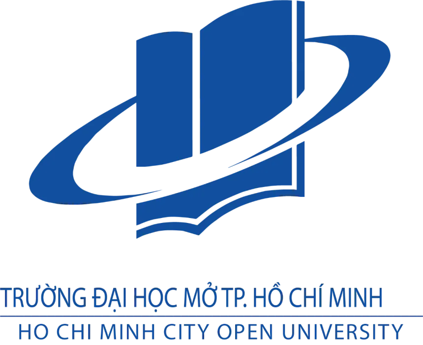

  

# Thực hành Các công nghệ mã nguồn mở

Kho lưu trữ tài liệu thực hành môn Các công nghệ mã nguồn mở do giảng viên cung cấp, được nhóm tập hợp để phục vụ học tập.

## Thành viên nhóm

- Phạm Đặng Quốc Viễn
- Lê Khắc Tùng
- Phạm Quý Trưởng

## Mục lục

- [Nội dung thực hành Lab02](./Lab02/README.md)
- [Cách sử dụng](./USAGE.md)
- [Hướng dẫn đóng góp](./CONTRIBUTING.md)
- [Thông tin giấy phép](./LICENSING.md)

Tài liệu thực hành thuộc quyền của giảng viên hoặc chủ sở hữu tương ứng. [Giấy phép MIT](./LICENSE) chỉ áp dụng cho phần do nhóm tự biên soạn; xem [phạm vi giấy phép](./LICENSING.md).
